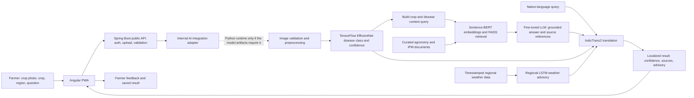

# AgroConnect

AgroConnect is a farmer-focused crop support application for disease identification, agronomy guidance, and local agricultural services. Its design prioritizes field use, regional languages, and clear next steps for Indian farmers.

> **Project status:** The project reports its Phase 1 model-development work as complete. Phase 2 application integration, end-to-end evaluation, and deployment remain. The current PWA diagnosis endpoint still returns a fixed example and does not analyze an uploaded image.

## Where the project stands

The active delivery target is the Angular PWA with a Java Spring Boot application API. Flutter is the previous Android/web app and remains project history, not a parallel client target. The selected AI approach uses TensorFlow/EfficientNet crop classification, FAISS-backed agronomy retrieval, a fine-tuned LLM, regional LSTM weather advice, and IndicTrans2 localization.

| Area | Current state |
| --- | --- |
| Farmer app | Angular PWA is the active client. Flutter is the previous Android/web application. |
| Public app API | Spring Boot `POST /api/diagnose` in the PWA starter currently returns a fixed example. |
| AI integration | Spring Boot owns the public API and request workflow. Integrate the existing AI runtime behind an internal service adapter; use Python/FastAPI internally only where the TensorFlow/LLM artifacts require it. |
| Crop diagnosis | EfficientNet CNN with TensorFlow, crop-image preprocessing, and a disease class/confidence result; integration and field evaluation remain. |
| Treatment guidance | Sentence-BERT embeddings + FAISS retrieval over curated agricultural/IPM material, then a fine-tuned LLM response with traceable sources. |
| Weather | Region-specific LSTM over sequential weather data for a separate weather advisory, not as proof of crop disease. |
| Languages | IndicTrans2/AI4Bharat is the selected translation approach, with a stated target of India's 22 scheduled languages. The current design preview covers English, Hindi, and Marathi only. |
| Hosting and identity | Google Cloud and Firebase are named in the technical design; deployment configuration and security rules remain to be documented. |
| Data | Project notes report 450+ disease/pest classes. The class inventory, image rights, splits, model artifacts, and evaluation results are not in this documentation checkout. |

The PWA starter baseline is Angular 17, TypeScript 5.3, Java 21, and Spring Boot 3.3.1. Keep Spring Boot as the only public app API. If model dependencies require Python, expose one private inference/RAG adapter behind Spring Boot rather than a second farmer-facing API.

## Agreed technical approach

Development is organized into two phases: Phase 1 covers model development and fine-tuning; Phase 2 covers application implementation, integration, and deployment. This flow makes the integration boundary explicit:



Spring Boot remains the single public API and coordinates the PWA workflow. The internal adapter can call the existing Python model runtime without exposing a second farmer-facing API.

### Data and evaluation context

| Data | Intended use | Required checks before deployment |
| --- | --- | --- |
| Crop photos and disease labels | EfficientNet training/inference | Inventory all classes; record source, license, crop, region, capture conditions, and label reviewer. Split by source/farm/region to reduce near-duplicate leakage. |
| Agronomy and IPM documents | FAISS/Sentence-BERT retrieval and LLM grounding | Preserve publisher, URL, version/date, section/page, usage rights, and review date in every indexed chunk. Return citations with advice. |
| Regional weather sequences | LSTM weather-risk advisory | Record station/provider, location, timestamp, units, missing-data handling, forecast horizon, and update time. Backtest chronologically against a simple baseline. |
| Language examples and translations | IndicTrans2 input/output localization | Track source and translated text versions; review agricultural terms with fluent domain reviewers for each launched language. |
| Farmer feedback | Quality monitoring and future model improvements | Obtain consent, minimize personal data, separate feedback from identity, and define retention/deletion rules. |

The previous README's “450+ diseases and pests” figure is a project-note claim, not a verified class count. Publish a versioned dataset manifest and evaluation report before presenting coverage or accuracy numbers as established results.

### Model and service improvements

- Keep EfficientNet as the agreed image-model baseline. Compare newer/mobile-efficient candidates only on the same leakage-resistant field-photo split; promote a replacement only when per-crop recall, calibration, latency, and device/cloud cost improve.
- Project notes describe the fine-tuned model as GPT-based, while older notes mention Gemma 2B. Resolve the checkpoint name, tokenizer, license, quantization, and benchmark against the model artifact. Keep a provider/model adapter so the product does not depend on an unverified label.
- Benchmark the selected LSTM against persistence and an available trusted forecast feed. Display its location, horizon, issue time, and uncertainty. Keep weather advisories separate from diagnosis confidence.
- Evaluate vision with per-class precision/recall, macro-F1, confusion matrix, calibration, and low-confidence abstention. Evaluate RAG with retrieval recall/ranking, citation support, and expert review. Evaluate weather using chronological MAE/RMSE and decision-specific error costs.
- For each launch language, test typed input, translated output, agricultural terminology, fallback behavior, and mixed-language queries. Treat 22 languages as a target until each has completed review.

## Run the starter

Prerequisites: Node.js and npm, Java 21, and Maven. Run each service in a separate terminal from the repository root.

```bash
cd frontend
npm install
npm start
```

```bash
cd backend
mvn spring-boot:run
```

The frontend development server is available at `http://localhost:4200` by default. The backend runs on `http://localhost:8080`. The diagnosis endpoint is `POST /api/diagnose` and currently returns a static example, regardless of the image. There is no Maven wrapper in the repository, so these instructions use an installed Maven command.

## Resume development

Start by making the existing application reproducible and integrating the selected AI pipelines:

1. Run the frontend and backend using the instructions above; record any setup or build failures.
2. Expose the existing EfficientNet model through the selected FastAPI boundary; define the image request/response contract, validation, confidence, and abstention behavior.
3. Connect the existing FAISS/Sentence-BERT index and fine-tuned LLM. Return cited source passages and abstain when retrieval cannot support an answer.
4. Publish a versioned manifest for the existing image classes, training/evaluation split, source licenses, checkpoint, and benchmark results.
5. Connect the region-specific weather model to timestamped data and backtest it against persistence or a trusted forecast baseline before showing advisories.
6. Integrate IndicTrans2 and publish a language support matrix only after agricultural terminology review for each language.
7. Complete PWA installability, offline behavior, accessibility, privacy controls, monitoring, and deployment runbooks.

## Production-readiness improvements

Keep the selected models as the baseline; modernize through measured upgrades, not model-name changes.

- **Checkpoint clarity:** Project notes identify the fine-tuned LLM as GPT-based, while older notes say Gemma 2B. Confirm the actual checkpoint, tokenizer, license, and serving requirements from the model artifact before documenting a provider or deploying it. This is an artifact/documentation check, not a request to rebuild the model.
- **Vision quality:** Evaluate the existing EfficientNet on a source/region-separated field-photo set with per-class recall, macro-F1, calibration, low-confidence abstention, and latency. Compare newer/mobile models only if they improve those results and fit device/cloud constraints.
- **RAG grounding:** Preserve source, section, version, and review date in FAISS metadata. Add retrieval and citation checks; test hybrid retrieval or reranking only if they improve the reviewed evaluation set.
- **Weather safety:** Validate the LSTM with chronological holdouts and a forecast baseline. Show region, timestamp, forecast horizon, and uncertainty. Weather risk may inform an advisory but must not be presented as a crop-disease diagnosis.
- **Language quality:** Use IndicTrans2 for the planned language coverage, with human review of crop names, symptoms, measurements, and treatment terminology. Fall back clearly when a language or source is unsupported.
- **Farmer trust:** Keep diagnosis, source-backed advice, weather alerts, and community experience visually distinct. Require human-reviewed source data and avoid specific treatment instructions unsupported by retrieved material.

## Proposed wireframes

[View the implementation-ready screen designs](docs/wireframes.html). Home puts photo-based crop diagnosis first, then local weather and advisory, followed by a horizontally scrollable crop-guide list. Five fixed tabs follow the original app: Home, Crops, Prices, Weather, and Profile. Additional screens cover a crop library and growing guide, AI chat, farmer community, mandi prices, and state/crop-specific schemes. English, Hindi, and Marathi previews are available. Current diagnosis, weather, market, community, and scheme data services still need app integration before deployment.

## Existing AI pipeline resources

These Colab notebooks preserve earlier image-embedding and RAG experiments. They are not the source of truth for the selected EfficientNet checkpoint or fine-tuned LLM; reconcile their contents against the versioned model manifest before integration. The model services still need to be connected to the application API and deployment workflow.

- [Crop disease image-embedding notebook (Google Colab)](https://colab.research.google.com/drive/1Ofhbm7w5_ieNhxDtnmfKlPlw8ZnU7sO-?usp=sharing)
- [RAG treatment-guidance notebook (Google Colab)](https://colab.research.google.com/drive/1V5oEq-q5Ypiri3eCXti7sOdwXQVyHoQB)

The original project notes cite [TNAU crop protection](https://agritech.tnau.ac.in/crop_protection/crop_prot.html), [Plantix plant diseases](https://plantix.net/en/library/plant-diseases/), [ICAR](https://icar.org.in/), [DARE](https://dare.gov.in/en), and [PPQS](https://ppqs.gov.in/) as potential data or information sources. Check the terms, attribution requirements, and suitability of each source before using its material in a dataset or production feature.

## Project docs

- [Proposed wireframes](docs/wireframes.html)
- [Project board](PROJECT_BOARD.md)
- [Issue backlog](GITHUB_ISSUES.md)
- [Contributing guide](CONTRIBUTING.md)

Contributions are welcome in reproducible evaluation, data documentation, AI integration, PWA behavior, accessibility, and multilingual UX. See the [contributing guide](CONTRIBUTING.md) before opening a change.
